  
  
  
  
  
  

  

# 🛡️ Awesome Quality Assurance & Audit Management

> 🚀 **The definitive, curated guide to Enterprise Quality Management Systems (eQMS), Audit Management platforms, automated compliance verification tools, Corrective and Preventive Actions (CAPA) engines, and open-source GRC workpaper frameworks.**

Whether you are implementing ISO 9001 / ISO 13485 quality lifecycles, preparing for an FDA 21 CFR Part 11 inspection, enforcing continuous SOC 2 and ISO 27001 audit readiness, or setting up automated evidence collection pipelines, this collection covers both market-leading commercial SaaS platforms and production-grade open-source tools.

---

## 📑 Table of Contents

- [🌐 Sector Overview & Market Dynamics](#-sector-overview--market-dynamics)
- [🟦 SaaS / Hosted Platforms](#-saas--hosted-platforms)
- [🟩 Open-Source Software](#-open-source-software)
- [📊 Comparison Matrix](#-comparison-matrix)
- [🎯 Implementation Guide & Best Practices](#-implementation-guide--best-practices)
- [🤝 Contributing](#-contributing)
- [💖 Support & Sponsorship](#-support--sponsorship)
- [📈 Star History](#-star-history)
- [📄 License](#-license)

---

## 🌐 Sector Overview & Market Dynamics

The global Quality Management Software (QMS) and Audit Management software sector is estimated at **$13.8 billion to $15.5 billion (2026)** and projected to expand at a compound annual growth rate (CAGR) of **10.8% to 12.4%**, surpassing **$30 billion by the mid-2030s**. 

The sector exhibits **moderate fragmentation with strong vertical concentration**: broad horizontal GRC and general manufacturing quality remain distributed across niche players and ERP add-ons, whereas mission-critical, heavily regulated domains (such as life sciences, pharmaceutical validation, medical devices under FDA 21 CFR Part 11 / EU MDR, and aerospace under AS9100) are dominated by entrenched, high-moat platforms (e.g., Veeva Systems, MasterControl, Honeywell Sparta TrackWise, and Hexagon ETQ).

---

## 🟦 SaaS / Hosted Platforms

Leading commercial, enterprise-grade Quality Assurance, eQMS, and Audit Management software suites. Ranked in descending order of vendor scale (company valuation and annual revenue).

| Vendor / Platform | Company Scale (Valuation / Revenue) | Starting Pricing (Specific Tier) | Free Tier Limits / Trial Specifics | Core Focus & Regulated Standards | Deployment & Architecture |
| :--- | :--- | :--- | :--- | :--- | :--- |
| **[Veeva Vault QMS](https://www.veeva.com/products/vault-qms/)** | **~$48B Valuation** (~$3.2B ARR, NYSE: VEEV) | **$125,000/year** base platform tier (named user licensing ~$1,200–$2,400/user/year) | **No Free Tier / No Self-Service Trial**; customer validation sandboxes provided solely under pre-sales NDA contract | End-to-end Life Sciences QMS, Deviations, Change Controls, Quality Risk Management, FDA 21 CFR Part 11, GxP, ISO 13485 | Cloud-Native Multi-Tenant SaaS (Veeva Vault Platform) |
| **[TrackWise / TrackWise Digital](https://www.spartasystems.com/trackwise-digital/)** | **$1.3B Valuation** (Acquired by Honeywell NYSE: HON, ~$38B Rev) | **$200/user/month** (~$2,400/user/year, TrackWise Digital baseline entry tier) | **No Free Tier / No Public Free Trial**; access restricted to guided enterprise demos and paid proof-of-concept (PoC) sandboxes | Life Sciences & Heavy Manufacturing eQMS, CAPA Management, Out-of-Specification (OOS), FDA 21 CFR Part 11, ISO 9001 | Cloud SaaS (Salesforce Force.com foundation) or On-Premise Enterprise |
| **[MasterControl](https://www.mastercontrol.com/)** | **$1.3B Valuation** (Sixth Street Growth, ~$200M+ ARR) | **$1,000/user/month** (Enterprise packages starting ~$25,000/year platform baseline) | **No Free Forever Tier**; **30-day guided evaluation sandbox** provisioned for verified organizations upon scoping consultation | Document Control, CAPA, Supplier Quality, Electronic Batch Records (EBR), 21 CFR Part 11, ISO 9001/13485 | MasterControl Manufacturing Excellence Cloud SaaS |
| **[ETQ Reliance](https://www.etq.com/)** | **$1.2B Valuation** (Acquired by Hexagon AB, ~$75M+ ARR) | **$25,000/year** baseline tier (Concurrent User CCU model ~$180–$350/CCU/month) | **No Free Tier / No Self-Serve Trial**; custom 14-to-30 day interactive enterprise PoC sandbox available following technical review | Scalable QMS & EHS for Manufacturing, Automotive, Aerospace & Life Sciences (ISO 9001, AS9100, IATF 16949) | Hybrid Cloud SaaS (AWS-backed) and Private Dedicated Hosting |
| **[Qualio](https://www.qualio.com/)** | **~$350M Valuation** (Series B Tiger Global, ~$25M ARR) | **$25,000/year** (Foundation tier; includes 5 editor seats, unlimited read/train seats) | **No Free Forever Plan / No Self-Serve Trial**; personalized live product walkthrough demos provided by solutions engineers | Fast-growing Medical Device & Biotech startups/scale-ups; ISO 13485, ISO 9001, FDA 21 CFR Part 820 / Part 11 | Multi-Tenant Cloud SaaS |
| **[ComplianceQuest](https://www.compliancequest.com/)** | **~$144M Valuation** (Insight Partners Series A, ~$58M ARR) | **$30/user/month** (AppExchange baseline module seat; complete suites quote ~$15,000–$25,000+/year) | **No Free Forever Plan**; **30-day interactive sandbox trial** available on Salesforce AppExchange for qualifying Salesforce tenants | Native Salesforce-based 100% cloud QMS & EHS; Document Control, Audits, CAPA, Non-conformance, Supplier Quality | 100% Salesforce Cloud-Native Multi-Tenant SaaS |

---

## 🟩 Open-Source Software

Self-hosted, community-driven Quality Assurance, Audit Management, compliance validation, and continuous GRC workpaper engines. Sorted in descending order of GitHub stargazers.

| Repository & Tool | Community Stars | Primary Technology Stack | License | Core Capabilities & Quality Assurance Modules | Standards & Compliance Focus |
| :--- | :--- | :--- | :--- | :--- | :--- |
| **[Aqua Trivy](https://github.com/aquasecurity/trivy)** |  | Go / Multi-Platform CLI | Apache 2.0 | Comprehensive security and compliance audit scanner for container images, Git repositories, virtual machine filesystems, and Kubernetes clusters; automated SBOM evidence generation. | CIS Benchmarks, NSA/CISA Guidelines, FedRAMP, CycloneDX, SPDX |
| **[osquery](https://github.com/osquery/osquery)** |  | C++ / SQL / Shell | Apache 2.0 | SQL-powered operating system instrumentation and live audit telemetry; exposes OS metadata as relational tables to inspect compliance baselines, integrity checks, and configuration deviations. | NIST 800-53, PCI-DSS Audit Logging, CIS OS Benchmarks, SOC 2 Evidence |
| **[Wazuh](https://github.com/wazuh/wazuh)** |  | C / Python / Elasticsearch | GPL-2.0 | Enterprise open-source security monitoring and regulatory compliance agent; continuous file integrity monitoring (FIM), configuration assessment, automated log inspection, and active incident response. | PCI-DSS v4.0, HIPAA Security Rule, GDPR, NIST SP 800-53, TSC SOC 2 |
| **[Lynis](https://github.com/CISOfy/lynis)** |  | POSIX Shell / Modular | GPL-3.0 | Battle-tested security auditing and compliance verification tool for Linux, macOS, and UNIX operating systems; scans system configurations, file permissions, and generates actionable hardening suggestions. | ISO 27001, PCI-DSS, HIPAA, CIS Benchmarks |
| **[OWASP DefectDojo](https://github.com/DefectDojo/django-DefectDojo)** |  | Python / Django / React | BSD-3-Clause | Open-source vulnerability management, remediation tracking, and security audit orchestrator; ingests findings from 160+ security testing tools, manages root-cause CAPA workflows, and reports verification status. | OWASP ASVS, ISO/IEC 27001, SOC 2 Type II, FedRAMP Evidence |
| **[Dolibarr CAPA Manager](https://github.com/Dolibarr/dolibarr)** |  | PHP / MySQL / Web | GPL-3.0 | Deep structured CAPA and deviation management module for manufacturing and pharmaceutical environments; includes **5-Why root cause analysis**, containment actions, CAPA effectiveness checks, and audit trails. | ISO 9001:2015, GMP, GLP, LabQC Pro Workflows |
| **[ComplianceAsCode](https://github.com/ComplianceAsCode/content)** |  | Python / Jinja2 / SCAP | LGPL-2.1 | Declarative security and compliance content repository providing ready-to-run automated configuration policies and auditing templates for enterprise operating systems, containers, and applications. | DISA STIG, NIST CSF, PCI-DSS, ANSSI, CIS Benchmarks |
| **[OpenSCAP](https://github.com/OpenSCAP/openscap)** |  | C / Python / XSLT | LGPL-2.1 | NIST-certified SCAP 1.2 scanner and audit framework; executes automated vulnerability checks, validates configuration adherence, and outputs formal HTML/XML audit workpapers. | NIST SP 800-126, SCAP 1.2, USGCB, Federal Compliance |
| **[Odoo Management System](https://github.com/OCA/management-system)** |  | Python / Odoo / PostgreSQL | AGPL-3.0 | Comprehensive nonconformity and quality audit suite maintained by the Odoo Community Association (OCA); tracks nonconformities, immediate corrections, preventive actions, and reviewer evaluations. | ISO 9001 (Quality), ISO 14001 (Environment), ISO 45001 (Health & Safety), ISO 27001 |
| **[DearAuditor QMS Baseline](https://github.com/AliakseiT/dearauditor-qms-baseline)** |  | GitHub Actions / Issues / Markdown | Open Source | A GitHub-native eQMS baseline for regulated medical device and digital health teams; ships with 1 published Quality Manual, 23 standard operating procedures (SOPs), 2 work instructions, and training matrices. | ISO 13485, ISO 9001, ISO 14971, IEC 62304, IEC 62366-1, FDA 21 CFR Part 11 |
| **[AuditSym](https://github.com/SUALBA/AuditSym)** |  | JavaScript / HTML5 / LocalStorage | MIT | Offline-first, AI-assisted GRC and audit execution workbench; features local RAG for PDF policy exploration, risk acceptance approval workflows, and professional executive audit PDF generation. | NIST CSF 2.0, ISO 27001:2022, CIS Controls v8, COBIT 2019 |
| **[pHKapa](https://github.com/pHAlkaline/phkapa)** |  | PHP / CakePHP / MySQL | MIT | Lightweight web application for managing non-conformances and action plan requests (CAPA); enforces register, review, plan, implementation, and quality verification lifecycles. | ISO 9001 Quality Assurance, Nonconformance Management |
| **[grc-lake](https://github.com/koda-ai-studio/grc-lake)** |  | Python / Helm / Docker | Apache 2.0 | Self-hosted GRC evidence lake and audit engine; continuously collects control artifacts, validates versioned control rules, tracks evidence freshness, and creates hash-chained workpaper snapshots. | SOC 2 Type II, ISO/IEC 27001, Model Context Protocol (MCP) Integration |

---

## 📊 Comparison Matrix

| System / Tool | License Tier | Architecture | CAPA Workflow | Multi-Standard Audits | Digital Audit Trail | Automated Evidence Gathering | Best Deployment Match |
| :--- | :--- | :--- | :--- | :--- | :--- | :--- | :--- |
| **Veeva Vault QMS** | Proprietary SaaS | Multi-Tenant Cloud | Full Enterprise GxP | Yes (Life Sciences) | Cryptographic 21 CFR 11 | Yes (Platform Integrations) | Global Pharma & Biotech Enterprises |
| **TrackWise Digital** | Proprietary SaaS | Force.com Cloud | Automated CAPA/OOS | Yes (Multi-Site) | Validated Audit Log | Yes (Honeywell Forge) | Regulated Discrete & Process Manufacturing |
| **MasterControl** | Proprietary SaaS | Cloud SaaS | Deep 5-Why & CAPA | Yes (Internal/Supplier) | Electronic Signatures | Yes (MES & EBR Integrations) | Mid-Market to Enterprise Life Sciences |
| **ETQ Reliance** | Proprietary SaaS | Hybrid Cloud | Integrated EHS & QMS | Yes (Cross-Industry) | Comprehensive Trail | Yes (IoT & ERP Connectors) | Aerospace, Automotive, Industrial Mfg |
| **Qualio** | Proprietary SaaS | Cloud SaaS | Guided CAPA | Yes (eQMS Audits) | Timestamped E-Signs | Partially (REST API Webhooks) | Early-Stage to Series B MedTech Startups |
| **ComplianceQuest** | Proprietary SaaS | Salesforce Cloud | Native Salesforce Flow | Yes (Audit Planning) | Salesforce History Trail | Yes (Salesforce Ecosystem) | Companies Standardized on Salesforce |
| **Aqua Trivy** | Apache 2.0 | CLI / Kubernetes Agent | Remediation Tracking | Yes (CIS/NSA Benchmarks)| JSON/SARIF Logs | Continuous Real-Time | Cloud-Native Infrastructure & DevOps |
| **osquery** | Apache 2.0 | Daemon / SQL Engine | External Ticket Link | Yes (SQL Rules) | Syslog / Streaming Query | Continuous Scheduled Daemon | Zero Trust & Enterprise Fleet Auditing |
| **Wazuh** | GPL-2.0 | Distributed Server-Agent| Active Incident Response| Yes (Regulatory Matrices)| FIM & Event Ledger | Continuous Log Ingestion | Self-Hosted SOC & Regulatory Auditing |
| **Lynis** | GPL-3.0 | Standalone Shell Script | Hardening Advice | Yes (System Hardening) | Local Report & Log File | On-Demand or Cron-Automated | Linux Systems & Server Baseline Audits |
| **OWASP DefectDojo** | BSD-3-Clause | Django App / Docker | Vulnerability Deduplication| Yes (AppSec Audits) | Model History Logs | CI/CD Pipeline Ingestion | Software Engineering & AppSec Assurance |
| **Dolibarr CAPA** | GPL-3.0 | PHP / ERP Module | 5-Why Root Cause | Deviation Audit Trail | Database Journal | Manual & LabQC Integration | Small/Mid Manufacturing Quality Teams |
| **ComplianceAsCode** | LGPL-2.1 | Policy-as-Code Repo | Automated Remediation | Yes (DISA/CIS/NIST) | Test XML/XCCDF Results | Automated SCAP Scanners | Defense, GovCloud & Hardened Systems |
| **OpenSCAP** | LGPL-2.1 | Native C Framework | Shell Script Remediation| Yes (SCAP Profiles) | Signed OVAL/ARF Workpapers| Automated Scanning Engine | Regulated Linux Workstations & Servers |
| **Odoo Mgmt System**| AGPL-3.0 | Python / ERP Module | Integrated Action Plans | Nonconformity Reviews | Object Audit Logs | Internal ERP State Triggers | Companies Running Odoo Community ERP |
| **DearAuditor** | Open Source | GitHub Repo Template | SOP-002 CAPA via Issues | SOP-003 Internal Audits | Git Commit & Release History | GitHub Actions CI/CD Hooks | Software-as-a-Medical-Device (SaMD) Teams |
| **AuditSym** | MIT | Pure Browser App | Remediation Matrix | NIST/ISO/CIS Scopes | Browser LocalStorage | Local Semantic PDF Search | Offline Audit Teams & Remote Assessors |
| **grc-lake** | Apache 2.0 | Python Service / Docker | Rule Failure Alerts | Framework Coverage Grid | Immutable Hash-Chained | S3, CloudTrail, REST APIs | Modern DevSecOps & Security Data Lakes |

---

## 🎯 Implementation Guide & Best Practices

1. **Classify Regulatory Mandates Early**:
   - For FDA 21 CFR Part 11 or EU Annex 11 adherence, verify that your selected platform natively supports strict electronic signature manifests, reason codes for record modification, and computer system validation (CSV / CSA).
   - If pursuing ISO 9001 or ISO 13485 certification, verify that the CAPA module enforces an independent **Effectiveness Check phase** before allowing issue closure.
2. **Bridge the Gap Between DevOps and Quality Assurance**:
   - Modern software engineering teams benefit from adopting policy-as-code frameworks (such as [ComplianceAsCode](https://github.com/ComplianceAsCode/content) or [DearAuditor](https://github.com/AliakseiT/dearauditor-qms-baseline)) to translate regulatory clauses directly into GitHub Actions or GitLab CI/CD verification stages.
3. **Automate Evidence Freshness**:
   - Manual screenshot collection represents over 60% of compliance preparation costs. Integrate continuous telemetry tools like [osquery](https://github.com/osquery/osquery), [Aqua Trivy](https://github.com/aquasecurity/trivy), or [grc-lake](https://github.com/koda-ai-studio/grc-lake) to capture immutable machine evidence automatically.

---

## 🤝 Contributing

Contributions are welcomed with open arms! Help us make this the most complete, accurate, and actionable resource for quality, compliance, and audit professionals:

1. 🍴 Fork the repository.
2. 🌿 Create a descriptive feature branch (`git checkout -b feature/add-new-qms-tool`).
3. 📝 Follow our quality criteria:
   - Must be actively maintained with verifiable open-source license or clear enterprise SaaS presence.
   - For open-source tools, include the standard GitHub social star badge linking to the project's stargazers page.
   - Specify accurate pricing models and realistic free-tier/trial terms.
4. 🚀 Submit a Pull Request with a clear summary of additions.

---

## 💖 Support & Sponsorship

If you find this repository helpful in designing or selecting your Quality Assurance and Audit Management infrastructure, please consider supporting the project:

- ⭐ **Star** this repository on GitHub to help others discover it.
- 🍴 **Fork** and share with your quality, DevOps, and compliance teams.
- ☕ **Buy Me a Coffee**: Support ongoing open-source curation and development via the [GitHub Sponsor Dashboard](https://github.com/sponsors/ishandutta2007).

Thank you for supporting open-source quality engineering and compliance automation! 🙏

---

## 📈 Star History

---

## 📄 License

To the extent possible under law, [Ishan Dutta](https://github.com/ishandutta2007) has waived all copyright and related or neighboring rights to this work. Product trademarks, logos, and service marks are the property of their respective owners.

---

⭐ **If you find this Quality Assurance & Audit Management directory valuable, please star this repository!** ⭐
